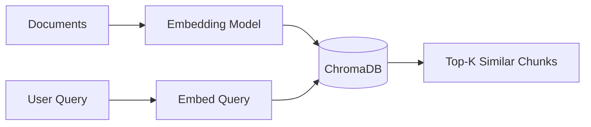

# 02 - Vector Databases

Embeddings, ChromaDB, and metadata filtering.

## Contents

| Resource | Original Path |
|----------|---------------|
| ChromaDB Intro | `GenAI_ChromaDB_Intro_Resources/1_getting_started_with_chromadb.ipynb` |
| Metadata Filtering | `GenAI_Metadata_Filtering_Resources/3_metadata_filtering.ipynb` |
| Vector DB Exercise | `GenAI_Exercise4/` (healthcare patient records) |

---

## Architecture (Basic Vector Store)

---

## Learning Objectives

- Create and persist a Chroma collection
- Add documents with metadata
- Perform similarity search
- Filter by metadata
- Prepare data for RAG pipelines
