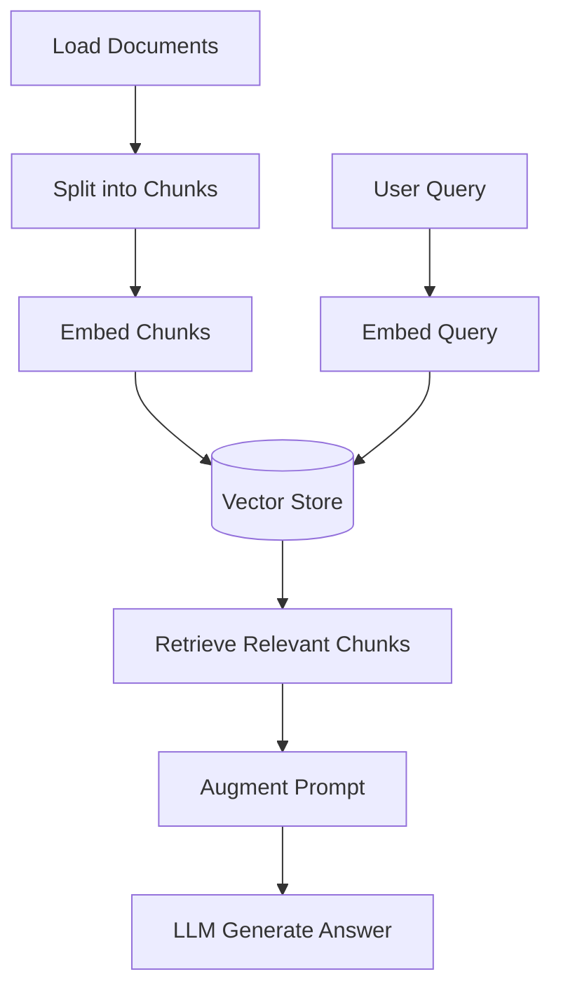

# 03 - RAG Systems

Document loading, text splitting, and full retrieval-augmented generation pipelines.

## Contents

| Resource | Original Path |
|----------|---------------|
| Document Loader | `GenAI_Project1_resources/1_document_loader/` |
| Text Splitter | `GenAI_Project1_resources/2_text_splitter/` |
| Real Estate Tool | See `07-projects/real-estate-rag` |
| Project resources | `GenAI_Project1_resources`, `GenAI_Project2_resources`, `GenAI_Project3_Resources` |

---

## Standard RAG Pipeline

---

## Learning Objectives

- Load PDFs, CSVs, URLs, etc.
- Choose appropriate text splitters
- Build and query a vector store
- Construct RAG chains with source attribution
- Add conversation memory to RAG
