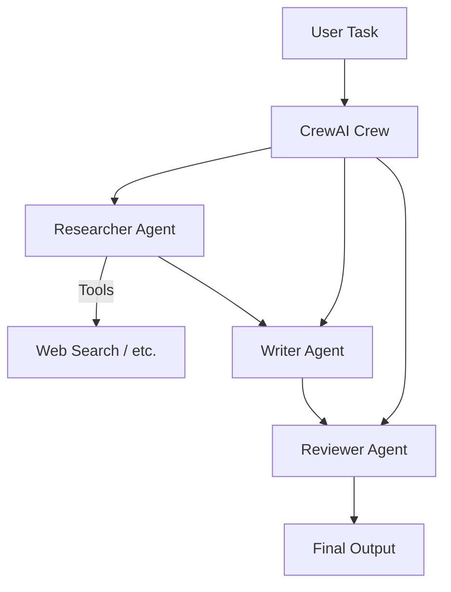

# 05 - Multi-Agent (CrewAI)

Hands-on with CrewAI framework for collaborative agents.

**Original source:** `bode_casics_aigen/Gen_AI_CrewAI_Crash_Course`

## Contents

| Notebook / File | Focus |
|-----------------|-------|
| `1_email_agent.ipynb` | Basic email agent |
| `2_email_agent_with_tool.ipynb` | Agent + tools |
| `3_crew.ipynb` | Full crew |
| `4_crew_with_tools.ipynb` | Crew with tools |
| `5_yaml.py` / `6_memory.py` | Configuration & memory |
| `marketing-crew/` | Example marketing crew |

---

## Architecture (Typical Crew)

---

## Learning Outcomes

- Defining agents with roles and goals
- Task assignment and sequential / hierarchical processes
- Tool usage inside agents
- YAML-based configuration
- Memory in multi-agent systems

Reference: [Google CrewAI example](https://ai.google.dev/gemini-api/docs/crewai-example)
