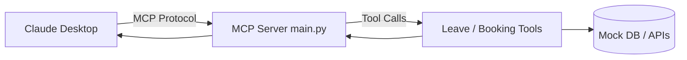

# 06 - MCP (Model Context Protocol)

Learn to build MCP servers that expose tools to Claude Desktop or other MCP clients.

## Projects

### Leave Management MCP Server
- **Objective:** HR assistant that answers leave-related queries from a mock database.
- **Original:** `bode_casics_aigen/GenAI_Leave_Management_APP`
- Tools interact with leave data and respond to MCP client calls.

### Cab Booking MCP (Exercise 8)
- Integrates custom MCP server with Google Maps MCP.
- Book cabs, plan itineraries via Claude Desktop.

---

## Architecture (Typical MCP Server)



---

## Setup Pattern (uv)

```bash
uv init leave-mcp
cd leave-mcp
# copy main.py
uv run mcp install main.py
# Restart Claude Desktop
```

See individual project folders for exact steps.

---

## Learning Outcomes

- MCP tool definition
- Server ↔ Client communication
- Integration with Claude Desktop
- Combining multiple MCP servers (e.g., Google Maps + custom)
