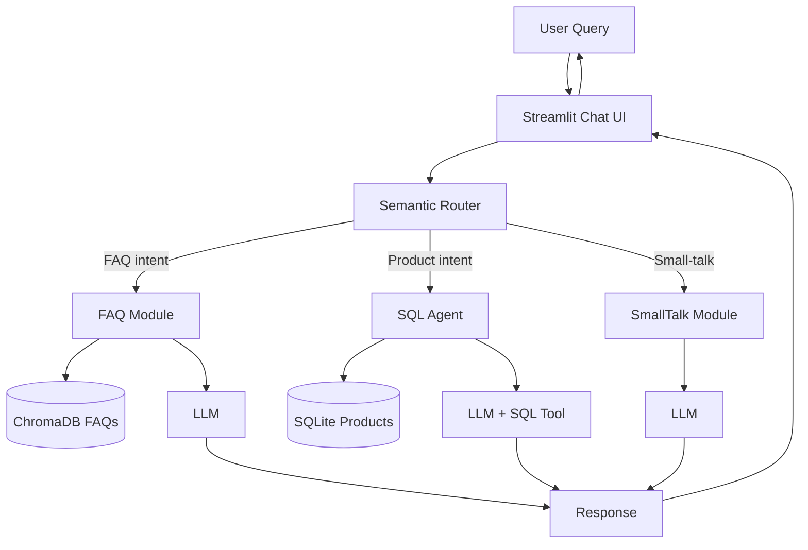

# E-commerce Chatbot (Semantic Router)

**Objective:** Build a chatbot that routes user queries to the right backend:
- FAQ questions → ChromaDB vector search
- Product / pricing questions → SQLite SQL generation
- Small talk → Direct LLM

Matches the Flipkart Chatbot SOW (Phase 1: Streamlit + FAQ + Product inquiries).

---

## Architecture

---

## Key Components

| File | Role |
|------|------|
| `router.py` | Intent classification / routing |
| `faq.py` | Vector retrieval for FAQs |
| `sql.py` | NL → SQL over product DB |
| `smalltalk.py` | Casual conversation |
| `main.py` | Streamlit entry point |
| `web_scrapping/` | Flipkart data extraction → SQLite |

---

## Data Flow

1. Scrape / load product data into SQLite
2. Load FAQs into ChromaDB
3. User message → router decides path
4. Appropriate tool/LLM generates answer

---

## Setup

Original code lives in `bode_casics_aigen/GenAI_Exercise6/Exercise_Solution/`.

- Requires Groq API key
- SQLite DB already present in solution (`db.sqlite`)
- Streamlit frontend

---

## Learning Outcomes

- Semantic / intent routing
- Combining RAG (FAQ) + Text-to-SQL
- Multi-route chatbot architecture
- Data ingestion (scraping → structured DB)
- Production-style separation of concerns (router, handlers)

---

## Related

- Flipkart SOW PDF in original repo
- Architecture diagram image in original Resources folder
