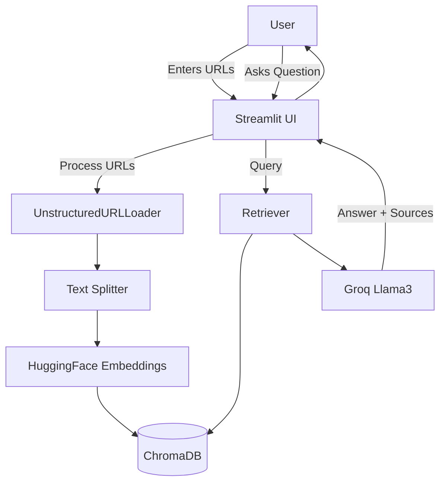

# Real Estate Research Tool (RAG)

**Objective:** Build a Streamlit app that lets users load news article URLs, embed them, and ask questions about the content using RAG.

**Domain:** Real estate (extensible to any domain).

---

## Architecture



---

## Key Components

| Component | Responsibility |
|-----------|----------------|
| `main.py` | Streamlit UI + orchestration |
| `rag.py` | Document loading, embedding, retrieval, generation |
| `prompt.py` | Prompt templates |
| ChromaDB | Vector store |
| HuggingFace | Embeddings |
| Groq | LLM (Llama3) |

---

## Setup

1. Copy code from original: `bode_casics_aigen/GenAI_Exercise5/Exercise_Solution/`
2. Create `.env`:
   ```
   GROQ_MODEL=llama-3.1-70b-versatile
   GROQ_API_KEY=your_key
   ```
3. `pip install -r requirements.txt`
4. `streamlit run main.py`

---

## Learning Outcomes

- URL loading with LangChain
- Chunking and embedding pipeline
- ChromaDB persistence
- RAG chain with source citations
- Streamlit multi-step UI (sidebar processing + chat)

---

## Original Source

`https://github.com/yash9614/bode_casics_aigen/tree/main/GenAI_Exercise5`
